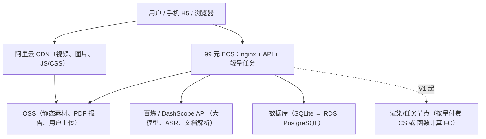

# Growth Hub 技术部署书（99 元 ECS 版）

> 版本 v1.0 ｜ 2026-11-16 ｜ 适用：阿里云 ECS `ecs.e-c1m1.large`，华东1（杭州）可用区 J，2 vCPU / 2 GiB，ESSD Entry 40 GiB，固定带宽 3 Mbps，Alibaba Cloud Linux 3
> 依据：`.codex-context/TECH_SPEC.md`（原按 2C4G 设计）、老板《产品与功能模块 V1.0》（MVP → V1 四智能体与工作台 → V2 API）、当前官网 `website/`（总量 13 MB，含 3 个视频共 10.1 MB）。
> 说明：标注【经验值】的数字是通用工程估算，上线前需用压测实测校准。

---

## 1. 结论（先看这里）

1. **99 元机足够承载「官网 + 备案 + MVP（内容—诊断—转化）」**，不足以单机硬扛「V1 四智能体 + 经营工作台」的全部负载。
2. **本方案的核心思路：这台机器只做“轻的、必须在国内备案主机上的事”，重的全部外包给云服务**——大模型走百炼 API、文件与视频走 OSS + CDN、数据库在 V1 起独立。这样 99 元机是**入口层**，可随时被替换而不重做架构。
3. 两个硬瓶颈必须先处理：
   - **带宽 3 Mbps ≈ 0.37 MB/s**：官网 `hero.mp4` 4.8 MB，单个访客就要约 13 秒；多人同时访问会直接卡死。→ 视频/图片必须上 OSS + CDN。
   - **内存 2 GiB**：Postgres + API + Worker + Chromium 渲染 PDF 同时跑会 OOM。→ 渲染与重任务串行或外移，加 swap。
4. 99 元权益约束（来自购买页）：每账号同时仅 1 个实例享受；可优惠续费 1 次/满年；不可过户；占用该权益去续其他低价实例会让原 99 元实例永久失去低价续费资格。→ **99 元机上不要放“不可迁移”的状态**，一切配置脚本化（见 §7）。

---

## 2. 资源盘点与容量边界

| 资源 | 规格 | 可用预算（扣除系统） | 影响 |
|---|---|---|---|
| CPU | 2 vCPU，经济型共享（e 系列，不保证持续满载性能）【经验值】 | 持续负载建议 < 40% | 不跑模型推理、不做批量计算 |
| 内存 | 2 GiB | 系统+nginx+监控约 350 MB，**业务可用约 1.5 GiB** | 见 §3 内存预算 |
| 系统盘 | ESSD Entry 40 GiB | 系统 8 GB、日志/数据 ≤ 20 GB | 文件、备份不落本机 |
| 公网带宽 | 3 Mbps 固定 | ≈ 0.37 MB/s | 静态大文件必须 CDN |
| 地域 | 杭州可用区 J | — | 与 OSS、百炼选同地域（内网免流量费、低延迟） |

**稳定承载量估算【经验值】**：纯静态官网（视频走 CDN 后）并发数百无压力；MVP 动态接口（表单、诊断提交）约 20–50 并发；PDF 渲染同一时刻 1 个任务。

---

## 3. 内存预算（决定服务如何拆）

| 组件 | 常驻内存【经验值】 | 部署策略 |
|---|---|---|
| 系统 + sshd + 云监控 | ~300 MB | 保留 |
| nginx | ~20 MB | 常驻 |
| API（FastAPI，单 worker 进程） | ~150–250 MB | 常驻，`--workers 1`（2 进程会吃掉太多） |
| Postgres（调小：`shared_buffers=128MB`，`max_connections=20`） | ~250–400 MB | **MVP 用 SQLite/WAL 起步；V1 再切 RDS 或本机 PG** |
| 任务 Worker（队列消费） | ~150 MB | 与 API 同镜像，必要时合并为一个进程 |
| Chromium（Playwright 渲染 PDF） | **峰值 400–700 MB** | **按需拉起、渲染完退出；同时只允许 1 个**；V1 后外移 |
| 余量 | ≥ 300 MB | 防 OOM |

硬性措施：配置 **2 GiB swap**（ESSD Entry 性能有限，swap 仅作缓冲，不是常态）；给各容器设 `mem_limit`；开启 `vm.overcommit_memory=1` 前先压测；systemd 设 `OOMScoreAdjust` 保护 nginx 与 API，让 Chromium 先被杀。

---

## 4. 总体架构：分三阶段演进

### 阶段 P0：官网 + 备案期（现在 → 备案通过）
- **形态**：纯静态站（`website/`，nginx），与现有 `deploy.sh` 一致。
- **部署**：ECS 装 nginx，站点目录 `/srv/growthhub/site`；先开 80，备案通过后配 443（Let’s Encrypt 或阿里云免费证书）。
- **必须做**：
  1. 视频 `hero.mp4 / v-workbench.mp4 / v-report.mp4` 转码（H.264，hero ≤ 1.5 MB、其余 ≤ 1 MB，或首屏改海报图 + 点击/滚动后懒加载）；原件放 OSS，通过 CDN 域名（如 `static.growthhub.cn`）引用。
  2. 安全组仅开 80/443；SSH 改非 22 端口 + 仅密钥登录 + 限源 IP。
  3. 备案敏感点保持现状（已按组网方案书整改：不含支付、直播、投资等表述），不新增表单类功能直到备案通过。
- **ECS 负载**：几乎为零，这是 99 元机最舒服的阶段。

### 阶段 P1：MVP 「内容—诊断—转化」（备案通过后）
- **形态**：官网 + 增长诊断 H5（免登录 token 链接）+ 留资/预约咨询 + 内部简易后台（查看线索与诊断结果）。**不收费、不在线支付**（保持“非经营性导流站、线下签约”定性）。
- **技术栈**（沿用 TECH_SPEC，按 2G 收缩）：
  | 层 | 选择 | 相对原方案的调整 |
  |---|---|---|
  | API | FastAPI + SQLAlchemy | 单进程 |
  | 数据库 | **SQLite（WAL）起步**，迁移脚本用 Alembic，保证可平滑切 PG | 原为本机 PG16 |
  | 任务 | 进程内队列 / `jobs` 表串行执行 | 与原方案思路一致，去掉独立 Worker 进程 |
  | 前端 | 静态打包的 Vue/或原生 H5，走 CDN | 无 SSR |
  | LLM | 仅调用 **百炼 API**（OpenAI 兼容），保留 `llm.chat()` 抽象 | 本地 Qwen/vLLM **取消**（2G 无法运行，见 §6） |
  | 文件 | 直传 OSS（服务端签发 STS/PostPolicy），本机不存用户文件 | 原为本机磁盘 |
  | PDF | 优先「HTML 打印样式 + 浏览器端导出」或 **FC 函数计算**渲染；ECS 内渲染仅作兜底且串行 | 原为 ECS 内 Playwright |
- **容量**：诊断提交为小 JSON + 一次 LLM 调用，主要耗时在 LLM 等待，ECS CPU 基本空闲，20–50 并发可行【经验值】。
- **限流与防滥用**：nginx `limit_req`、表单手机号/验证码接入阿里云短信（国内合规）、LLM 调用设日额度与单用户频率上限（防刷爆 API 账单）。

### 阶段 P2：V1 四智能体 + 统一网页经营工作台
这是 99 元机**单机无法完整承载**的阶段，按下表拆分：

| 能力 | 放在哪 | 理由 |
|---|---|---|
| nginx、API 网关、鉴权、会话 | 99 元 ECS | 轻量、需备案主机 |
| 数据库 | **RDS PostgreSQL 基础版（或 ECS 内 PG，视预算）** | 数据是命脉，不与应用抢内存，且自带备份 |
| 四智能体（内容生成/增长诊断/数据洞察/运营自动化） | 编排逻辑在 API 内，**推理全走百炼**；长任务入队异步执行 | 无本地模型 |
| 重任务（PDF 渲染、文档解析、批量数据洞察） | **按量付费 ECS（用时开机）或 函数计算 FC** | 避免常驻成本，不压 99 元机 |
| 文件/素材/报告 | OSS（私有 Bucket + 签名 URL） | 带宽走 CDN/OSS，不占 3 Mbps |
| 搜索缓存、限流计数 | 先用进程内/SQLite；并发上来再加 Redis | 原方案“不引入 Redis”的原则保留到真有需要 |
| 监控告警 | 阿里云云监控 + 简单 `/healthz` 探活 + 短信/钉钉告警 | 零额外内存 |

**升级触发线（任一满足即升配或拆分）**：
- 内存 5 分钟均值 > 80%，或 1 天内出现 OOM 事件；
- CPU 持续 > 60% 超过 10 分钟；
- API P95 延迟 > 2 秒（排除 LLM 等待时间后）；
- 注册活跃用户 > 200 或同时在线 > 30（工作台常驻连接开始吃内存）。

### 阶段 P3：V2 API 与平台协同
- API 对外开放、多租户、审计、计费 → 此时应 **迁到 ≥ 4C8G 的主机或容器服务（ACK/ECI/SAE）**，99 元机退为官网/落地页或备用节点。
- 因为 P0–P2 一直保持 “无状态应用 + 外置数据/文件/模型”，迁移只是改 DNS 与镜像，不需要重写。

---

## 5. 各形态“如何部署”一览

| 形态 | 99 元机承担 | 外部依赖 | 是否可行 |
|---|---|---|---|
| 官网（静态） | 全部 HTML/CSS/JS | CDN + OSS（视频、图片） | ✅ 轻松 |
| 备案/ICP 站点 | 全部 | — | ✅ |
| 增长诊断 H5（MVP） | API + 页面 | 百炼、短信、OSS | ✅ |
| 留资 / 预约咨询 | API + 表单 | 短信/邮件 | ✅ |
| 内部后台（线索、报告审校） | 轻量页面 + API | 数据库 | ✅（单人/小团队） |
| AI 企业分析报告（编辑器 + PDF） | 编辑器 API、锁、版本 | PDF 渲染外移、OSS | ⚠️ 需外移渲染 |
| 经营工作台（多用户常驻） | 网关与鉴权 | RDS、百炼、FC | ⚠️ 需拆分，限定内测规模 |
| 四智能体（内容/诊断/洞察/自动化） | 编排与队列 | 百炼 API | ⚠️ 仅编排，推理外置 |
| 本地私有部署（客户保密项目） | ❌ 不在此机 | 客户机房 GPU 机 + 同一 compose | ❌ 另走“私有交付包” |
| 语音转写（访谈 ASR） | 仅提交与回调 | 百炼 Paraformer | ✅ 外置 |
| 对外开放 API（V2） | ❌ | 迁移至更大规格 | ❌ 届时迁移 |

---

## 6. 与原 TECH_SPEC 的差异（因 2C4G → 2C2G）

| 原方案 | 99 元版调整 | 原因 |
|---|---|---|
| Docker Compose：nginx/api/worker/web/postgres 同机 | **P0–P1 用 systemd 直跑**（API+nginx），少一层 Docker 守护进程的内存与复杂度；P2 起视情况再容器化 | 节省约 100–200 MB |
| 本机 PostgreSQL 16 | SQLite → RDS | 内存与可靠性 |
| ECS 内 Playwright 渲染 PDF | 外移（FC/按量机） | Chromium 峰值内存 |
| 文件落本机磁盘 | OSS 直传 | 40 GB 盘与 3 Mbps |
| 本地 Qwen（vLLM/Ollama） | 取消，仅云 API；保密客户走“私有交付包” | 2G 无法运行 |
| 夜间 `pg_dump` 到 OSS | 保留（SQLite 用 `.backup`） | 备份仍必须有 |

---

## 7. 可迁移性与 99 元权益风险对冲

99 元权益规则让这台机器存在“被占用/不可过户/续费限制”的约束，因此：

1. **基础设施即脚本**：新增 `deploy/` 下的一键初始化脚本（装 nginx、systemd 单元、swap、防火墙、证书、日志切割）。任何新机 10 分钟内复原。
2. **状态外置**：数据库（RDS/定期备份）、文件（OSS）、配置（`.env` 不入库，用密码管理工具/阿里云 KMS 或 OOS 参数）。
3. **域名与证书独立于实例**：DNS 在云解析 DNS，指向可变；备案主体与服务器 IP 绑定的变更需提前走备案变更流程（升级/换机前先查阿里云备案规则，避免断站）。
4. **到期预案**：到期前 60 天评估是否续 99 元（若权益被其它实例占用将按原价）；备选 ≈ 2 年 ¥2,440.97 方案已在购物车。
5. **快照策略**：每周自动快照（保留 2 份），重大变更前手动快照。

---

## 8. 安全与合规基线

- 网络：安全组仅 80/443；SSH 改端口、仅密钥、限源 IP；开启云安全中心基础版（账号下已有 1 个云安全中心实例）。
- 应用：argon2 密码、登录失败锁定、Cookie `Secure/HttpOnly/SameSite`、CSRF；诊断链接 32 字节随机 token + 过期/可撤销。
- 数据：个人信息最小化采集；隐私说明页已上线；传给大模型的内容做最小化与脱敏，并核验百炼数据使用条款；日志不记录完整手机号与问卷原文。
- 备案红线：不上线在线支付、直播、投资/撮合交易、社区发帖（与官网 20261116f 口径一致）；新增任何交互功能前先对照备案方案书。
- 备份：每日数据库备份到 OSS（加密、生命周期保留 30 天），每月做一次恢复演练。

---

## 9. 运维与监控

| 项 | 做法 |
|---|---|
| 探活 | `/healthz`，云监控 1 分钟探测，失败短信/钉钉 |
| 资源告警 | 内存 > 80%、CPU > 60%（10 分钟）、磁盘 > 75%、带宽使用率 > 80% |
| 日志 | nginx/应用日志 logrotate 按天，保留 14 天；错误日志推 SLS（按量，量小） |
| 发布 | `git pull` + 脚本构建 → 软链切换 → `nginx -s reload`；保留上一版以便回滚 |
| LLM 成本 | 日额度、单用户频率、调用日志（token/耗时/费用），超线自动降级为“稍后处理” |

---

## 10. 实施路线（建议）

| 步骤 | 内容 | 产出 |
|---|---|---|
| 1 | 下单 99 元机（见购物车）、设登录凭证、系统初始化脚本、swap、安全组 | 可 SSH 的干净机器 |
| 2 | 视频转码 + 建 OSS/CDN，官网静态资源迁出 | 官网首屏 < 2 秒（国内） |
| 3 | 部署官网、提交备案资料、备案通过后开 HTTPS | 域名可访问 |
| 4 | MVP：诊断 H5 + 留资 + 简易后台，接百炼 API | 对外获客闭环 |
| 5 | 观察 2–4 周真实负载，据 §4 升级触发线决定 P2 拆分 | 压测与容量报告 |
| 6 | P2：RDS、渲染外移、工作台内测 | V1 内测版 |

---

## 11. 风险清单

| 风险 | 概率 | 影响 | 应对 |
|---|---|---|---|
| 3 Mbps 带宽被视频占满 | 高（不处理时） | 官网卡顿 | CDN + 视频转码（§4 P0） |
| 2G 内存 OOM | 中 | 服务中断 | 内存预算、mem_limit、swap、渲染外移 |
| 共享型 CPU 被限制 | 中 | 高峰变慢 | 不放持续计算；监控 CPU 积分/性能 |
| 99 元权益被占用/续费失败 | 中 | 成本涨到原价 | 脚本化可迁移、到期前评估 |
| 备案前改动导致驳回 | 中 | 工期延长 | 备案期只发布静态内容 |
| LLM 账单失控 | 中 | 成本 | 日额度与限频 |
| 服务器单点 | 高 | 宕机 | 快照 + 脚本重建 + 数据外置；P2 起考虑双节点 |

---

## 12. 已确认决策（2026-11-16）

| # | 事项 | 决定 | 说明 |
|---|---|---|---|
| 1 | 数据库 | **P1（MVP）用 SQLite（WAL），P2（V1）起切 RDS PostgreSQL** | 授权由我决定。MVP 数据量小、省内存；用 Alembic + SQLAlchemy 保持可平滑迁移，切换条件见 §4 升级触发线 |
| 2 | 视频 | **压缩并迁 OSS + CDN** | 用户同意。目标：hero ≤ 1.5 MB，其余 ≤ 1 MB 或首屏海报图 + 懒加载 |
| 3 | 保密客户 | **改为按项目交付“私有部署包”（客户机房/GPU 机）**，公司服务器不提供本地大模型 | 用户同意 |
| 4 | PDF 渲染 | **函数计算 FC（无服务器）**，ECS 内渲染仅作串行兜底 | 授权由我决定。按调用计费、无常驻成本、不占 99 元机内存；若 FC 无法稳定运行 Chromium 再退为按量 ECS |
